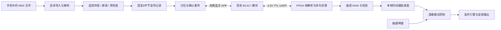

# 安卓手机向 FPGA 电子琴下载曲谱：项目规划

日期：2026-10-23。配套接口为同目录《通信协议_v1.md》。本规划覆盖设计、实现顺序和验收；目前尚未实现安卓 App 和 FPGA 下载逻辑。

## 1. 用户能完成的操作

手机连接电子琴，在手机中导入下载好的 MIDI 文件，选择主旋律或允许的声部，点击“下载到琴”。上传完整校验通过后显示成功，用户可在手机控制播放、暂停、继续和停止，也可停止自动播放后使用触摸琴键手动演奏。全过程不需要电脑转换曲谱或传输文件。

手机浏览器下载 MIDI 后通过系统文件选择器导入 App，是第一版的“手机下载曲谱”入口。自带在线曲库、账户、搜索与云服务不属于首版；后续可在原有导入链路上添加。

## 2. 已知条件与待确认项

### 已知

- 用户现有模块芯片丝印为 CSR BC417；照片显示6针底板和一个按钮，外形接近常见 HC-05，但固件与底板型号尚未最终确认。
- 用户确认底板 VCC 为5V，TX/RX 为3.3V。
- 用户报告已经成功连接；尚未通过应用层收发、环回和持续传输确认数据链路。
- 项目目录已有触摸琴键 PCB 资料与下载的 FPGA 合成器参考 HDL。参考工程不等于最终实际烧录工程，不能直接当作已集成的播放器。

### 开发前必须落实

| 项目 | 落实方法 | 影响 |
|---|---|---|
| FPGA 型号、开发板、主时钟 | 确认真实板卡与实际顶层工程 | UART 分频、定时器、引脚约束 |
| IO Bank 电压、可用引脚 | 核对原理图和开发板手册 | 能否直连模块3.3V UART |
| 模块固件、数据模式波特率 | 双向收发或有线串口查询；依据实际固件配置 | 稳定字节链路 |
| 模块数据连接是否正常 | 安卓 SPP 软件关闭本地回显，环回或有线收发 | 避免将仅配对成功当成透传通过 |
| 实际发声模块接口 | 确认音高映射、gate/trigger、包络、输出方式 | 自动播放接入点 |
| 剩余 BRAM 和可用声部数 | 综合报告和实物发声验证 | HELLO 中真实容量、音域和声部数 |

以上事项不妨碍先按协议开发安卓打包器、FPGA 接收器仿真和曲谱转换器。板卡未知时不填写虚构引脚或资源占用率。

## 3. 系统分工

手机承担文件格式和用户操作，FPGA 承担数据完整性、曲谱存储、演奏时序及声音生成。模块只透传字节，不承担曲谱转换或联网下载。

## 4. 首版功能与界面

### 连接

- 扫描/选择已配对的经典蓝牙设备，建立 SPP 连接并完成 HELLO。
- 显示设备容量、音域、声部数及连接状态。
- 连接失败、权限拒绝和断开时给出可操作的提示。
- 使用安卓原生 App；不依赖普通手机网页对经典蓝牙 SPP 的支持。

### 曲谱导入

- 通过系统文件选择器导入 `.mid`/`.midi`，不要求用户手动输入文件路径。
- 首版支持标准 MIDI 文件 Format 0/1、PPQN 时间基准；Format 1 合并轨道绝对时间并统一处理速度图。Format 2 和 SMPTE 时间基准明确提示不支持。
- 正确处理变长 delta、running status、Note On、Note Off、velocity=0 的 Note On 和变速事件。无速度事件时采用500000微秒/四分音符。
- 音符配对按 MIDI 通道和音高进行；相同通道/音高重叠时按先开始先结束配对。未配对结束事件或文件结束仍未结束的音符，作为导入错误提示。
- 首版不解释延音踏板、弯音、音色、表情与其他控制器。检测到会影响演奏的此类事件时提示“简化演奏”，由用户确认后转换；不能声称完整还原原曲。
- 可选择轨道/通道作为演奏声部；多声部文件不能自动视为单旋律。超音域、超容量、超声部限制必须提示，可由用户选择移调、筛选声部后重新检查。
- 手机侧完成绝对时间转换与整曲校验，排序后生成固定8字节记录和 CRC32；不要求 FPGA 识别 MIDI。

### 下载

- 下载前显示歌曲名、音符数、时长、容量占用，以及“上传会替换琴上原曲，RAM版本断电丢失”的说明。
- BEGIN 前若播放/暂停则先 STOP；每包推荐16条音符。
- 进度按 FPGA 确认的记录数更新。取消按钮发送 ABORT；若通信已经断开，提示琴端将在上传超时或下次 HELLO 时清理。
- 只有 COMMIT 成功才显示“下载成功”。断线重连后从头传，不从手机进度条推断琴端状态。

### 播放

- 播放、暂停、继续、停止，以及低频状态查询。
- 暂停冻结音乐时间并静音；继续时重新触发原活跃音符的剩余时长，声音包络可能重新起音。
- 自然结束与 STOP 后恢复手动弹奏，切换时防止挂音和按住琴键误触发。
- 首版如需改变速度，在手机端重新生成时间数据后重新下载；不额外添加实时调速协议。

## 5. FPGA 模块划分

建议新增模块采用清晰的流接口，内部信号在实际集成时与现有工程命名统一。

| 模块 | 职责 | 关键要求 |
|---|---|---|
| uart_rx | 接收8N1字节 | RX异步输入同步；采样和波特率误差容限经过验证 |
| uart_tx | 发送响应帧 | ready/valid握手，不能丢字节 |
| rx_fifo | 传输缓冲 | 溢出可检测；深度按 UART 与处理延迟预算 |
| frame_parser | 帧头、长度、CRC16、超时 | 最大载荷256；整帧有效后才提交 |
| command_engine | 序号、去重、命令、响应缓存 | 完整重复请求只回缓存，不重复产生副作用 |
| score_store | 单曲RAM、记录计数、CRC32 | 推荐1024×64bit=8KiB曲谱数据；另计FIFO与响应缓存 |
| score_validator | COMMIT 检查排序、范围、最大重叠 | 以声部结束时间表扫描，不展开成每毫秒数组 |
| score_player | 1ms逻辑时间、声部分配、音符结束 | 同一毫秒先结束后开始；本地计时不受蓝牙到包时间影响 |
| mode_control | 手动/上传/自动/暂停切换 | 清除旧触发和活跃音符；返回手动等待已有按键释放 |
| tone_engine_adapter | 接入现有发声模块 | 按声部传递音高、力度、开始/结束；明确同音高重叠行为 |
| status_registers | 曲谱、上传、播放、错误状态 | 与命令响应和播放器保持一致 |

模块原则上统一使用主时钟及 clock enable，避免用普通逻辑分频输出充当新时钟。BRAM 读延迟、最大同毫秒事件数量及声部释放/分配顺序必须纳入调度设计。

建议先实现 MAX_VOICES=1；只有真实引擎与调度都支持时，才提升为4或8，并更新能力信息。音域同样以实际音高映射为准。

## 6. 分阶段实施与验收

以下为单人顺序推进的工作量估计，合计约12～20个工作日；以实际发声模块成熟度和硬件问题为主要变量，不作为已承诺交付日期。

| 阶段 | 工作 | 交付与验收 | 估计 |
|---|---|---|---|
| P0 链路与板卡确认 | 模块正常连接、确定波特率/电平/引脚，确认实际FPGA工程 | 手机到模块串口及反向收发通过；记录硬件参数 | 0.5～1天 |
| P1 协议核心 | UART、缓存、帧解析、CRC、HELLO、序号去重、错误响应 | 黄金帧一致；拆帧/粘帧/坏CRC/超时/重复请求通过 | 2～3天 |
| P2 下载与存储 | BEGIN/DATA/COMMIT/ABORT，RAM与CRC32，曲谱约束 | 三音符与满容量曲谱正确；失败数据不可播放；重传不重复写入 | 2～3天 |
| P3 本地播放器 | 预置曲谱调度、接入发声、模式切换、暂停与停止 | 音高与时长正确；停止无挂音；暂停不推进时间 | 2～4天 |
| P4 安卓App | SPP、MIDI导入、能力预检查、上传进度和播放控制 | 手机独立完成导入、下载与播放；中断后可重新上传 | 4～6天 |
| P5 联调与交付 | 实物反复上传、异常恢复、界面说明、工程整理 | 完成下方验收清单，形成烧录与使用说明 | 1.5～3天 |

依赖关系：P0先确认硬件参数；P1→P2；P3可先用预置曲谱实现；P4按本协议和黄金数据开发，最终在P5合并验证。

## 7. 必须覆盖的验证

### 协议与上传

- 对最大帧执行分段接收，含逐字节输入、任意分界和多帧连续输入；载荷包含帧头字节时仍能正确解析。
- CRC16正确/错误、LEN超限、帧中断、FIFO溢出之后能够等待重传恢复。
- 丢失 BEGIN、DATA、COMMIT、PLAY 响应后重传：不重新初始化、不重复写入、不重复累计CRC、不重新开始播放。
- 同SEQ不同内容、过期SEQ、序号用尽、重新HELLO时的行为符合协议。
- 整曲CRC32错误、少传、多传、乱序索引、非法音符、零时长、同毫秒大量事件、超声部上限均被识别。
- BEGIN被拒绝时旧曲有效；BEGIN接受后旧曲失效；上传中断后绝不播放半曲。
- 上传超时、取消、断线重连、FPGA复位、手机进程重启均有明确恢复路径。

### MIDI转换

- Format 0与1，默认速度和多次变速，跨轨道事件合并，running status，velocity=0结束音符。
- 相同通道/音高重叠、同一时刻结束和开始、缺失配对事件、舍入后零时长。
- PPQN支持；SMPTE与Format 2明确拒绝；不支持的演奏控制事件有提示。
- 超音域/容量/声部限制不被静默忽略；转换后的黄金音符字节与预期一致。

### 实物播放与链路

- 先用三音符1900ms黄金曲谱，再用一首单旋律和容量边界曲谱；至少连续上传播放20次，记录失败原因。
- FPGA数字调度起止点相对协议时间误差目标不超过1ms，加上板载时钟本身的累计误差；音频包络和声卡延迟另行记录。
- 测量同毫秒多音符的调度延迟，确认最大输入规模下能在1ms内处理完成，不用肉耳代替数字时序验证。
- PAUSE/RESUME保持逻辑时间，STOP清除自动声部；切回手动无挂音、无切换误触发。
- 在9600完成完整链路后，如启用115200，重复传输验证，不仅测试一次HELLO。

## 8. 容量与上传时间预算

按1024条音符、每条8字节、每包16条计算：音符数据8192字节；DATA共64帧，每帧140字节，成功响应13字节。再计 HELLO、BEGIN、COMMIT 请求/响应，完整上传线缆字节数为9886字节，不含可选STOP与状态查询。

- 9600、8N1：纯UART串行占用约10.30秒；实际增加64次数据确认等待、蓝牙排队、应用调度与校验时间。
- 115200、8N1：纯UART串行占用约0.86秒；停等下实际速度仍明显受蓝牙往返等待影响。
- 以上是协议串行预算，不是实测吞吐或保证时间。每包16条是初始选择，后续在不改变协议的前提下可测试最多31条/包。

## 9. 后续扩展

完成首版后依次考虑：多声部、设备端Flash保存、多首歌曲目录、在线曲库、跟弹提示，以及图片/PDF识谱。Flash擦写与原子替换、多曲目索引、断线续传和新增控制命令需要单独版本设计，不能只设置能力位便声称支持。

若希望上传失败后保留旧曲，需要双存储区和原子切换：这是明确的资源与交互变化，纳入后续版本，不让首版单RAM实现承担隐含承诺。

## 10. 最终交付物

1. 本协议、项目规划、机器可读黄金数据和校验程序。
2. 可安装安卓APK与完整源码，包含构建步骤和已支持的MIDI范围。
3. FPGA完整工程、RTL、仿真文件、实际开发板引脚约束、综合结果与可烧录文件。
4. 蓝牙模块真实配置记录、接线图、手机操作说明与已知限制。
5. 协议仿真和实物验收记录；分别标注软件自检、仿真、综合和硬件测试，不能相互替代。
