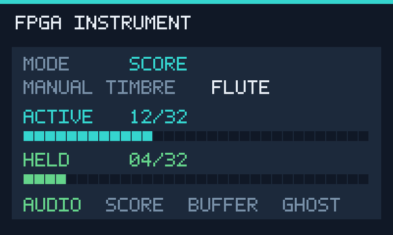

> 2026年10月23日：本文件保留周建涛分支的硬件和历史实现记录。最新整合界面与控制连接见[instrument_ui.md](instrument_ui.md)，显示状态现为64位、渲染为两级寄存器；触摸默认仍关闭。

# 800×480 RGB 屏开发

2026-10-22 已从独立渲染推进到原顶层RGB显示接入，并按用户进一步要求增加GT9110触摸首版。开发基于本地 `f285506` 功能源码及 `fdab3c5` UI基线，未合并远端回声/板载按钮分支。音源、键盘、播放器及原两个音频PLL保持原样；新增独立像素PLL、显示/触摸端口和对应约束。尚未点亮实屏，不能把HDL通过当作面板兼容性或STA验收。

触摸按用户指定SCL=AB26、SDA=U25、INT=V23、RST=R23，已实现读取与UI十字/原始坐标，详见[GT9110触摸首版](touch_gt9110.md)。用户已明确没有其他屏幕资料，后续不再以继续索取手册为前提暂停开发。

## 用户指定引脚依据

用户在本轮明确示例目录为 `E:\FPGA竞赛\开发板资料\09_Misc`，其中唯一 CST 是 `tang_mega_138k-pro_pins.cst`。已读取原件，并核实与仓库 [参考副本](../references/tang_mega_138k-pro_pins.cst) 逐字节相同，SHA256 为 `f647104f7b74800890d0283a438b226301bff3a3429a04ec0f6df63c9026e8ba`。用户已核对其与底板40P FPC屏幕接线一致，无需重复确认映射。

| 示例信号 | FPGA球位（数据按[5:0]从左到右） | 示例属性 | 与原24个端口冲突 |
|---|---|---|---|
| lcd_clk | H21 | BANK_VCCIO=3.3 / DRIVE=8 / PULL_MODE=NONE | 无 |
| lcd_hs | H22 | 同上 | 无 |
| lcd_vs | A23 | 同上 | 无 |
| lcd_en | A24 | 同上 | 无 |
| lcd_r[5:0] | H19 / J19 / G25 / H18 / J18 / K17 | 同上 | 无 |
| lcd_g[5:0] | J16 / K15 / F22 / G22 / G21 / G20 | 同上 | 无 |
| lcd_b[5:0] | F20 / G19 / F19 / F18 / M17 / M16 | 同上 | 无 |

共22个互不重复的球位，与原24个已约束端口无交集；初次记录见 [pinmap.json](../reports/display/2026-10-22/pinmap.json)，本轮包含触摸的50端口核查见[本轮引脚记录](../reports/display/2026-10-22/touch/pinmap.json)。已原位追加到 `src/keyboard.cst`，没有复制全引脚CST，也没有修改原24个端口属性。

已视觉核对底板4071f3原理图第14页：J20将每色低2位接地，FPGA六位依次接面板R/G/B[7:2]。因此渲染RGB888取每色高6位输出，不是RGB565。FPC第30针PCLK、第31针DISP固定3.3V、第32针HS、第33针VS、第34针DE；LCD供电来自底板3.3V，背光由板载LP3320驱动，不增加GPIO直接供电。面板及触摸的实际电压、背光电流均未测量。

## 可追溯的试亮时序

用户提供的QTB203V121C-40P（QT-070800-w）PDF共19页，明确800×480/RGB888/40P，但第6页fCLK栏为空，未给扫描时序或采样沿。没有将800×480分辨率自行换算成一个“已确定的厂家时序”。本版采用[Sipeed官方Pro 800×480示例](https://github.com/sipeed/TangMega-138KPro-example/tree/main/rgb_screen/800_480_screen)作为**可调整、待上板验证的参考配置**；并不能证明这块QTB面板与官方示例所用屏幕相同。

| 项目 | 本版试亮配置与依据 |
|---|---|
| 像素时钟 | 50MHz独立PLL，IDIV=1/FBDIV=1/MDIV=21/ODIV=30，35MHz；依据官方 `gowin_pll.v` 的实际系数，未沿用顶层过时的“10M”注释 |
| 水平有效/前/后消隐 | 800 / 210 / 182，合计1192像素时钟 |
| 垂直有效/前/后消隐 | 480 / 45 / 8，合计533行 |
| 模式 | DE-only，正有效DE，HS/VS保持无效高电平；官方示例没有使用HS/VS |
| 刷新率 | 35000000/(1192×533)，约55.09Hz，属于参考配置计算值 |
| 输出相位 | 内部上升沿寄存RGB/DE，默认输出PCLK反相，供屏在其上升沿取得半周期建立时间；这是可切换的试亮相位，面板真实采样沿未由手册确定 |

只参考官方参数，未直接复制其`<=`有效区和计数终点写法；本版采用半开区间与TOTAL-1回卷，保证每帧恰好800×480，不复制参考实现的多1像素/多1行问题；DE不与时钟组合门控。`rgb_scan_timing`支持显式同步宽度/极性及DE-only模式，未知参数缺省为无效哨兵0，不在通用模块暗藏厂家配置。试亮配置集中在原 `rgb_display` 参数中；若改变像素PLL频率，必须同步SDC中的生成时钟比例。

## UI 渲染接口与画面

[rgb_ui_renderer.sv](../src/rgb_ui_renderer.sv) 只在像素域绘图，不接触键盘/音符握手，不占用帧缓存。[rgb_display](../src/rgb_display.sv) 集成独立35MHz PLL、像素域复位、扫描、状态快照和渲染，由原 `keyboard_top` 实例化，工程现在28个HDL、39项依赖。`LCD_ENABLE=1`、`LCD_TEST_PATTERN=0`为默认状态UI；改为测试图参数1输出彩条，`LCD_ENABLE=0`关闭独立显示分支并将LCD输出置空闲。关闭重开原工程后加载文件列表。

画面显示自动曲谱/键盘模式、**手动选择音色**、活动声部数（含释放尾音）、按住声部数，以及音频就绪/谱错误/缓冲欠载/鬼键状态。它不把手动选择音色冒充曲谱或全部声部实际音色。当前为内置英文5×7点阵字，4倍放大；新增触摸状态/坐标/十字，没有加入中文字库、频谱或虚构的距离/音量读数。

`x[10:0]` / `y[10:0]` 是当前待绘制像素在有效区的坐标（0..799 / 0..479），配合 `de_in` 输入。非有效区及坐标越界输出黑色且 `de_out=0`。`rgb[23:0]` 按R/G/B各8位输出，RGB、DE、HS和VS全部在同一个上升沿寄存，具有一致的一拍延迟。外层取高6位并输出可选相位PCLK；另用复位掩码，在PLL失锁/停钟时不等待下一个像素边沿就清除RGB/DE。真实屏端建立/保持及板级偏斜仍需实测。

`rst` 是像素域高有效同步复位，清除显示状态及全部输出；将来由该域复位适配器同步释放，不能直接把音频域复位当像素域同步信号。HS/VS仅逐拍透传并延迟，极性由外部时序模块确定，复位期间输出0不代表面板复位极性已确定。

`frame_start` 必须在第一有效像素之前的消隐期给出单拍脉冲。仅当它与 `status_valid` 同拍为1时，模块锁存完整 `status_data[19:0]`；该帧其余时间输入任意变化均不会改变当前状态。无有效新状态则保留上一帧。若边界与首有效像素同拍，会有旧状态像素，因此禁止这种接法。

| status_data位 | 含义 |
|---|---|
| [5:0] | 活动声部数，显示范围0..32，超范围饱和到32 |
| [11:6] | 按住声部数，同上 |
| [13:12] | 手动音色0正弦、1笛管、2簧管、3显示问号 |
| [14] | 自动曲谱占用事件源，为0显示键盘模式 |
| [15] | 音频启动就绪：绿色；未就绪：琥珀色 |
| [16] | 曲谱错误：红色；未置位：灰色 |
| [17] | 音频缓冲欠载：红色；未置位：灰色 |
| [18] | 鬼键歧义：琥珀色；未置位：灰色 |
| [19] | 显示8条100像素宽的彩条和1像素边框，供后续点亮检查 |

**渲染接口本身不是CDC接口。** 外层已经添加 `rgb_status_cdc` 四相请求/应答快照，音频域32位声部图用平衡加法树计数，20位状态与39位触摸状态分别原子传递到像素域。仅单比特请求/应答做两级同步，载荷源寄存器在应答期间保持，目的端见同步后的应答才采样；显示帧内保持不变，允许跳过中间状态，不向音频或触摸反压。两域必须共用异步复位：任一音频/像素域失锁或复位均清除桥，两域分别同步释放；该模块不支持只复位一侧而保留另一侧握手状态。实际实现须检查同步器与载荷布线延迟，不以RTL仿真代替CDC物理验收。未添加笼统异步时钟组或多位载荷false-path。

触摸通过尾部 `touch_data[38:0]` / `touch_valid` 像素域输入，在同一个消隐帧起点锁存独立快照，字段及UI含义见触摸文档。TOUCH只观察传感器，不发音符或改变音量。

## 验证与预览

从工程根目录执行（只进行HDL仿真）：

```powershell
D:\py\python.exe scripts/run_sim.py --test tb_rgb_ui_renderer --out-dir reports/display/2026-10-22/renderer
D:\py\python.exe scripts/run_sim.py --test tb_keyboard_top --vendor --out-dir reports/display/2026-10-22/keyboard
```

渲染TB按800×480逐点检查寄存输出、HS/VS/DE对齐、半帧输入变化不撕裂；检查0..32和超范围声部计数、全部32格、三种音色与非法音色、模式/故障文字笔画、800列彩条顺序、边框、消隐/越界和中途复位。实际检查数见 [验证记录](../reports/display/2026-10-22/validation.json)。TB同时输出真实DUT像素 `renderer/ui_preview.ppm`（本地生成，不入Git）；[PNG预览](../reports/display/2026-10-22/ui_preview.png)由该文件无损转换，示例状态为自动播放、手动选择笛管、12活动/4按住，并非真实输入或上板照片。



上方初阶段验证与图片保留为历史；本轮驱动、触摸与音频回归见[本轮验证](../reports/display/2026-10-22/touch/validation.json)及[带触摸的RTL预览](../reports/display/2026-10-22/touch/ui_preview.png)，均为TB示例状态而非上板照片。新增时钟在原SDC中声明35MHz；LCD的6ns输出路线预算、触摸的100ns预算是工程约束，不冒充面板setup/hold数据。打包脚本新增50端口核查、像素时钟/第三PLL检查与相关TB清单，本轮只做Python语法检查，没有运行会启动EDA的打包/编译脚本。

2026-10-22用户实现时报告TA2000：原SDC第32行的`if/llength`被解析器拒绝。已改成直接的三条SDC命令，并按用户本轮综合网表将像素PLL路径改为`lcd_on.display_driver/pixel_pll/CLKOUT0`（generate实例名带点）。本SDC对应默认`LCD_ENABLE=1`；若将其改为0，需要同时删除像素域的这三条约束，不能用Tcl条件块自动选择。只做语法结构、差异和已有网表节点核对，助手未启动新的EDA解析/P&R；证据见[约束修正记录](../reports/display/2026-10-22/sdc_ta2000/validation.json)。此前HDL仿真不覆盖Gowin SDC解析，旧13配置记录仍属于修改前的RTL功能验证。

用户提供的资料不足以证明当前面板时序/电气兼容性，接下来由用户重新综合/P&R，确认50/61.44/35MHz三个域及新增CDC、无Setup/Hold违例、全部50个球位，然后烧录试亮。先看默认UI及触摸；若图像异常可改 `LCD_TEST_PATTERN=1` 检查彩条，再根据实测调整原配置。需要检查具体极性/相位时以单项对照方式修改，不能宣称参考参数已经过本屏验收。助手没有运行EDA、编程器或烧录。

